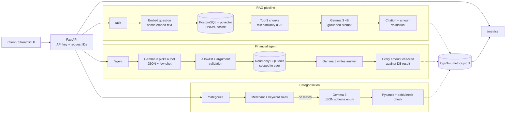

# FinSight AI

**A local-LLM financial assistant: RAG over finance documents, a tool-calling agent over bank transactions, LLM transaction categorisation, evaluation and observability.**


FinSight AI turns bank statements into a queryable financial dataset and puts three LLM features on top of it, all running locally with Ollama (no paid APIs):

| Feature | What it does | Endpoint |
|---|---|---|
| **Document Q&A (RAG)** | Answers personal-finance questions from a knowledge base, with source citations, and refuses when the documents don't support an answer | `POST /ask` |
| **Financial agent** | Answers questions about a user's transactions by choosing one of six read-only SQL tools | `POST /agent` |
| **Transaction categorisation** | Turns raw bank narrations (`UPI/DR/.../SWIGGY/...`) into a category, using rules first and the LLM only when rules can't decide | `POST /categorize` |

Every LLM call is validated (structured output, citation and amount checks), logged without prompts or answers, and summarised at `GET /metrics`.

> **Data:** all transactions are synthetic. Do not load real bank statements into a public deployment.

---

## Architecture



---

## Tech stack

| Area | Technology |
|---|---|
| Language | Python 3.11 |
| API | FastAPI, Pydantic |
| Database | PostgreSQL + **pgvector** (HNSW index) |
| LLM runtime | Ollama: `gemma3:4b` (generation), `nomic-embed-text` (embeddings, 768-d) |
| UI | Streamlit (dashboard, document chatbot, agent, evaluation pages) |
| Data | pandas, pdfplumber (PDF statements), psycopg 3 |
| Testing / CI | pytest, unittest.mock, GitHub Actions |

---

## Key design decisions

**RAG**
- 120-word chunks with 25-word overlap; embeddings stored in pgvector with an HNSW cosine index.
- Top-3 retrieval with a 0.25 similarity threshold. Below the threshold the system answers *"I couldn't find enough information…"* instead of guessing.
- The prompt treats retrieved text as data, not instructions. Answers must cite `[Source N]`; citations and currency amounts are validated against the retrieved chunks.
- Optional Pydantic structured output with a plain-text fallback.

**Agent and tool calling**
- Gemma 3 has no native function calling in Ollama, so the model returns `{"tool": ..., "arguments": ...}` in JSON mode, guided by 9 few-shot examples (including refusals).
- Only 6 allowlisted, read-only tools; unknown tools and extra arguments are rejected; limits are validated.
- Parameterised SQL only. The **user scope comes from the authenticated request, never from the model**.
- Every amount in the final answer must exist in the database result; otherwise the answer is rebuilt from a template. If the model fails after the query, the user still gets the database answer.

**Categorisation**
- Rules (merchant list + Indian bank keywords, whole-word, longest match wins, debit/credit aware) handle known merchants instantly.
- The LLM is called only for narrations no rule matches. Its output is constrained by a JSON schema whose `category` field is an enum of the allowed categories, then validated by Pydantic. An income category on a debit is rejected. Any failure falls back to `Others`.

**Security**
- API key on `/agent`, `/categorize` and `/metrics` (constant-time comparison).
- All-users queries are disabled unless `AGENT_ALLOW_ALL_USERS=1` is set for a trusted local demo.
- Database and model errors are logged; users get generic messages.
- Secrets only in `.env` (gitignored); all environment-specific settings come from environment variables.

**Observability**
- Every LLM call (RAG, agent, categoriser) writes one JSON line: feature, request ID, model, latency, prompt/completion tokens, status, error type. Prompts and answers are never logged (explicit allowlist).
- The API middleware adds an `X-Request-ID` to every response and links it to the LLM log lines for that request.
- `GET /metrics` reports call count, failure rate, average and **p95** latency, tokens and estimated cost, overall and per feature.

---

## Results

All results are from local runs on CPU with `gemma3:4b`. Test sets are synthetic and author-written, so they show that the system works and that changes can be measured, not that it generalises.

### RAG retrieval: 40 questions, 12 documents, pgvector

| Configuration | Hit@3 | MRR@3 | Document precision | Decision |
|---|---|---|---|---|
| **Baseline: top-3** | **100%** | **0.9875** | 0.758 | ✅ Kept |
| Top-5 | 100% | 0.9875 | 0.485 | ❌ Same recall, lower precision, more context |
| Top-3 + TF-IDF reranker | 97.5% | 0.9458 | — | ❌ Worse, +9.5 ms per query |

The reranker experiment is a deliberate negative result: on a small knowledge base, vector retrieval was already near-perfect and lexical reranking pushed some correct documents down. A cross-encoder reranker would be the next experiment at larger scale.

### Transaction categorisation: 52 labelled bank narrations

| Mode | Accuracy | LLM calls | Avg time / transaction |
|---|---|---|---|
| Rules only | 75.0% (39/52) | 0 | ~1 ms |
| **Hybrid (rules → LLM)** | **98.1% (51/52)** | 13 | ~3.3 s |

- Every rule match was correct; rules missed unknown merchants (`HALDIRAM SNACKS`, `NAMMA YATRI AUTO`, `OYO ROOMS`…).
- The LLM fixed 12 of the 13 misses, with no invalid outputs. Each LLM call took ~13 s on CPU, so calling it only for 25% of transactions matters.
- The one error: `ACH D- BAJAJ FINANCE LTD` → *Insurance* instead of *EMI*. Next step would be an "ACH debit + finance → EMI" hint, then re-running the evaluation.

### Agent (re-run 12 Nov 2026)

| Evaluation | Result | Avg latency (CPU) |
|---|---|---|
| Tool selection | 18/18 | ~18 s |
| Unseen phrasings (tool + arguments) | 30/30 | ~19 s |
| Unsafe requests refused (delete, transfer, SQL, secrets, prompt injection) | 24/24 | ~18 s |
| Final answers match the database | 6/6 | – |

The first request takes ~60 s while Ollama loads the model; `keep_alive` keeps it loaded for later requests.

### Automated tests

**131 unit and security tests** run in GitHub Actions on every push, with no database or model required (Ollama and PostgreSQL are mocked). Tests that need a real database or local files are marked `integration` and run locally.

---

## API

| Method | Path | Auth | Description |
|---|---|---|---|
| GET | `/health` | – | Service status and knowledge-base readiness |
| POST | `/ask` | – | `{"question": "What is an emergency fund?"}` → answer, sources, status |
| POST | `/agent` | `X-API-Key` | `{"question": "How much did I spend in total?"}` → answer, tool, DB result, timings |
| POST | `/categorize` | `X-API-Key` | `{"description": "UPI/DR/ HALDIRAM SNACKS", "transaction_type": "debit"}` → category, source |
| GET | `/metrics?hours=24` | `X-API-Key` | Failure rate, avg / p95 latency, tokens, cost per feature |

Interactive docs: `http://127.0.0.1:8000/docs`

---

## Setup (Windows PowerShell)

**Prerequisites:** Python 3.11, PostgreSQL with the `pgvector` extension, Ollama.

```powershell
git clone https://github.com/athrav53/FinSight-AI.git
cd FinSight-AI

py -3.11 -m venv .venv_clean
.venv_clean\Scripts\Activate.ps1
python -m pip install -r requirements.txt pytest httpx

Copy-Item .env.example .env      # then fill in DB_PASSWORD and add FINSIGHT_API_KEY
```

Add to `.env`:
```dotenv
FINSIGHT_API_KEY=choose-a-long-random-key
FINSIGHT_DEMO_USER_ID=USR00001
OLLAMA_BASE_URL=http://127.0.0.1:11434
```

Models and database:
```powershell
ollama pull gemma3:4b
ollama pull nomic-embed-text

psql -U postgres -c "CREATE DATABASE finsight_ai;"
psql -U postgres -d finsight_ai -f sql/schema.sql
```

Run:
```powershell
python -m streamlit run app.py          # UI: dashboard, document chatbot, agent, evaluation
uvicorn api.main:app --reload           # API: http://127.0.0.1:8000/docs
```

---

## Running tests and evaluations

```powershell
python -m pytest -m "not integration" -q                    # unit + security tests (no DB / Ollama)
python -m pytest -q                                         # everything, with PostgreSQL running

python -m evaluation.categorization_evaluator --modes rules hybrid
python -m rag.evaluate_pgvector                             # top-3 vs top-5 retrieval
python -m rag.evaluate_pgvector_reranker                    # baseline vs reranker
python -m tests.evaluate_agent
python -m tests.evaluate_agent_safety
python -m tests.evaluate_agent_unseen
python -m rag.observability                                 # LLM metrics summary
```

---

## Project structure

```text
agent/        financial_agent.py (tool selection, validation, answer check), tools.py (6 SQL tools)
ai/           categorizer.py (rules + LLM categorisation), llm_insights.py
api/          main.py (FastAPI), request_middleware.py (request IDs, timing)
rag/          pipeline, pgvector store, embeddings, reranker, observability, evaluations
ingestion/    PDF statement parsing and balance reconciliation
etl/          bank detection, cleaning, column mapping, validation, loading
evaluation/   test sets and evaluators (RAG, agent, categorisation)
tests/        pytest suite (unit, security, integration)
sql/          database schema
config/       categories, merchants, banks
app.py        Streamlit UI
```

---

## Limitations

- **Small, synthetic evaluation sets** written by the author; real statements and a held-out test set would give more realistic numbers.
- **CPU inference:** agent answers take ~10–40 s and LLM categorisation ~13 s per call. A hosted or GPU model would be needed for production latency.
- **One tool call per question:** the agent does not chain tools or keep conversation memory.
- **Authentication is a single API key** mapped to a demo user; production would need per-user auth.
- **Not containerised or deployed yet;** it runs locally.
- **Real bank PDFs** have only been tested with synthetic statements.

## Next steps

- Cross-encoder reranker and a larger knowledge base, re-evaluated with the same metrics
- Held-out evaluation on real (anonymised) statements; RAGAS-style answer metrics
- Hosted LLM option for low latency; Docker image and CI build
- Multi-step agent (e.g. LangGraph) only if questions need several tools; a single tool call doesn't need a framework

---

## Disclaimer

FinSight AI is an educational portfolio project. It is not financial, tax or investment advice.